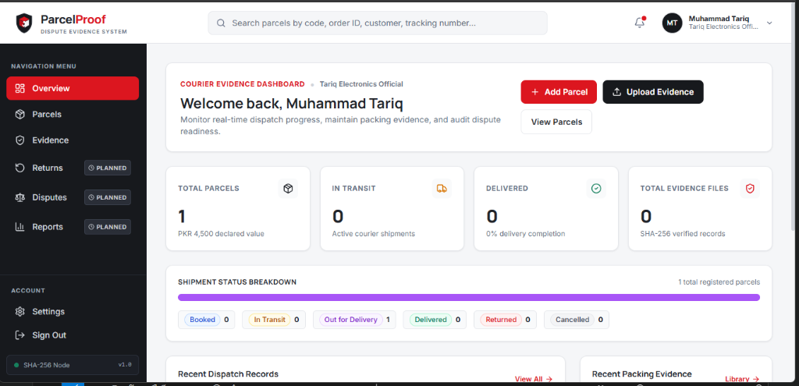
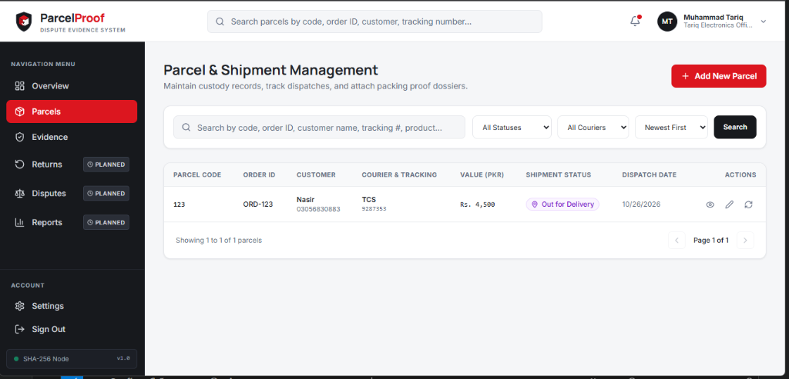
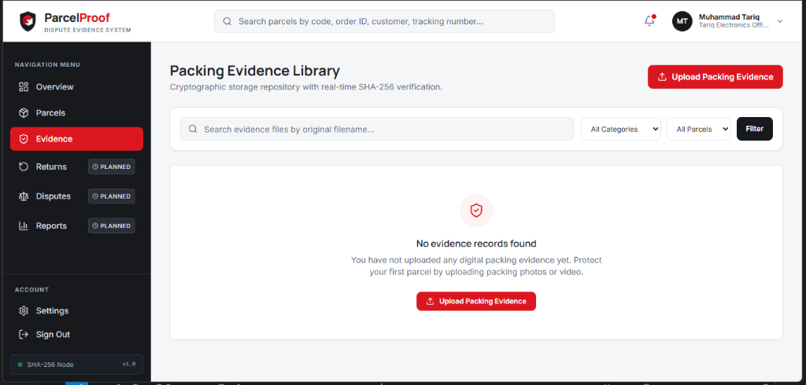

# ParcelProof — Courier Dispute Evidence Management System

ParcelProof is a professional MERN stack web application engineered for online sellers and e-commerce enterprises operating in Pakistan. It maintains structured shipment records and preserves cryptographically verified packaging evidence (photos, video footage, shipping labels, and booking receipts) for arbitrating courier shortage claims, damaged delivery disputes, and customer return discrepancies with major carriers such as **TCS**, **Leopards**, **M&P**, and **Pakistan Post**.

---

## Application Previews

| Overview Dashboard | Parcel & Shipment Management |
| :---: | :---: |
|  |  |

| Packing Evidence Library |
| :---: |
|  |

---

## 1. Core Architecture & Modules

The system encompasses six core business modules along with an integrated Overview Dashboard:

### Fully Functional End-to-End Modules

1. **Authentication & Seller Profile**
   - Seller registration with shop identity and phone validation.
   - Secure login powered by **bcryptjs** (salt rounds = 10) and **JWT** (JSON Web Tokens).
   - Protected routes with bearer token authentication headers and HttpOnly cookie fallback.
   - Seller profile management (shop name, official phone, warehouse address; email read-only).
   - Authenticated password modification verifying current credentials.

2. **Parcel & Shipment Management**
   - Complete CRUD lifecycle for consignments.
   - Standardized parcel code generation (`PRCL-XXXXXX`) and e-commerce order association.
   - Tracking reference recording for Pakistani couriers (**TCS**, **Leopards**, **M&P**, **Pakistan Post**, **Other**).
   - Manual courier status management (`Booked`, `In Transit`, `Out for Delivery`, `Delivered`, `Returned`, `Cancelled`).
   - Immutable shipment custody timeline recording state changes, timestamps, and milestone notes.
   - Strict seller-scoped ownership enforcement across all queries.

3. **Packing Evidence Management**
   - Multi-format digital evidence intake: **JPG**, **JPEG**, **PNG**, **WEBP**, **MP4**, and **PDF**.
   - Storage limits enforced: Images & PDFs up to **10 MB**, Videos up to **50 MB**.
   - Streamed **SHA-256 cryptographic digest computation** upon file receipt via Node.js `crypto`.
   - Stored in a private, non-public backend directory (`server/storage/uploads`).
   - Authenticated streaming endpoint for inline media preview and file download.
   - Real-time **Integrity Verification**: recalculates the SHA-256 checksum from physical disk bytes and validates against the recorded baseline using timing-safe comparison.

### Planned Modules (UI Foundation Previews)

4. **Return Inspection & Comparison**
   - Side-by-side photographic inspection layout comparing original dispatch evidence against incoming customer returns.
   - Return condition auditing checklist (tampered seals, broken packaging, accessories).
   - Neutral planned status indicators and disabled action triggers.

5. **Dispute Case Management**
   - Certified dispute dossier structure for formal courier claims.
   - Case status tracking, claim amount quantification, and case arbitration timeline.

6. **Reports & Analytics**
   - Intended carrier delivery success ratios, dispute win rates, and damage trends.
   - Disabled export controls for CSV manifests and PDF reports.

### Shared Screen

- **Overview Dashboard**
  - Aggregated real-time metrics computed directly via MongoDB aggregation pipelines (`$match`, `$group`).
  - Active parcel counts, delivery completion ratios, and total declared inventory value.
  - Quick action shortcuts to register parcels, upload evidence, and review inventory.

---

## 2. Technology Stack

### Frontend
- **Framework**: React.js 18 with Vite
- **Routing**: React Router DOM (v6)
- **State Management**: React Context API (`AuthContext`)
- **API Client**: Axios with request/response interceptors
- **Styling**: Tailwind CSS (White, Charcoal Black, Red design system)
- **Icons**: Lucide React
- **Typography**: Manrope (headings) & Inter (body text)

### Backend
- **Runtime**: Node.js & Express.js
- **Architecture**: MVC RESTful API architecture
- **Security**: Helmet, CORS, and Express Rate Limit (brute force protection on auth endpoints)
- **Authentication**: JWT (`jsonwebtoken`) & `bcryptjs`
- **File Uploads**: Multer with disk storage and MIME validation
- **Cryptography**: Node.js built-in `crypto` for SHA-256 calculation and timing-safe verification
- **Database ODM**: Mongoose

### Database
- **Engine**: MongoDB Community Server / MongoDB Atlas
- **Data Models**: `User`, `Parcel`, `Evidence` with ObjectId references, composite indexes, and validation rules.

---

## 3. Visual Design System

ParcelProof adheres to a refined logistics SaaS aesthetic:

| Token | Hex Value | Usage |
|---|---|---|
| **Primary Red** | `#DC161F` | Brand emblem, primary CTA buttons, active navigation indicator |
| **Red Hover** | `#B90F18` | Button hover and active states |
| **Sidebar Black** | `#17191D` | Navigation sidebar background, code blocks |
| **Main Background** | `#F5F6F8` | Application canvas background |
| **Cards** | `#FFFFFF` | Structured content cards and tables |
| **Primary Text** | `#202329` | High-contrast readable interface copy |
| **Secondary Text** | `#667085` | Subtitles, metadata, form labels |
| **Borders** | `#E5E7EB` | Clean structural dividing lines |
| **Success** | `#16805D` | Delivered status, SHA-256 verified badges |
| **Warning** | `#D97706` | In-transit indicators, notice alerts |
| **Error** | `#C62828` | Returned status, validation failures |

---

## 4. Local Installation & Setup (Windows)

### Prerequisites
- Node.js (v18 or higher)
- npm (v9 or higher)
- MongoDB Community Server (running on `mongodb://127.0.0.1:27017`) or a free MongoDB Atlas connection string.

### Step 1: Install Dependencies

From the project root:
```powershell
# Install both server and client packages
npm run install:all
```

Or install separately:
```powershell
cd server
npm install

cd ../client
npm install
```

### Step 2: Environment Configuration

The server environment file is located at `server/.env`. An example template is provided in `server/.env.example`:

```env
PORT=5000
NODE_ENV=development
MONGODB_URI=mongodb://127.0.0.1:27017/parcelproof
JWT_SECRET=parcelproof_super_secret_jwt_key_2026_secure
JWT_EXPIRES_IN=7d
CLIENT_URL=http://localhost:5173
UPLOAD_DIR=./storage/uploads
MAX_IMAGE_SIZE_MB=10
MAX_VIDEO_SIZE_MB=50
MAX_PDF_SIZE_MB=10
```

> **Note on Database Connection:**
> If MongoDB Server is installed locally on Windows, ensure the service is running (`net start MongoDB` or via `services.msc`). Alternatively, paste a MongoDB Atlas URI into `server/.env`. In development environments where local MongoDB is not yet started, the server automatically initializes an in-memory database fallback to ensure uninterrupted testing.

### Step 3: Run the Application

Start the backend server (runs on `http://localhost:5000`):
```powershell
npm run server
```

In a separate terminal, start the frontend client (runs on `http://localhost:5173`):
```powershell
npm run client
```

Open `http://localhost:5173` in your web browser.

---

## 5. REST API Documentation

### Authentication Routes (`/api/auth`)
| Method | Endpoint | Description | Access |
|---|---|---|---|
| `POST` | `/api/auth/register` | Register new seller with shop details | Public (Rate-limited) |
| `POST` | `/api/auth/login` | Authenticate seller and obtain JWT | Public (Rate-limited) |
| `POST` | `/api/auth/logout` | Clear authenticated session | Private |
| `GET` | `/api/auth/me` | Fetch authenticated seller profile | Private |
| `PUT` | `/api/auth/profile` | Update seller and shop details | Private |
| `PUT` | `/api/auth/change-password` | Change account password | Private |

### Parcel Routes (`/api/parcels`)
| Method | Endpoint | Description | Access |
|---|---|---|---|
| `GET` | `/api/parcels` | List parcels (search, filter, pagination) | Private |
| `POST` | `/api/parcels` | Create new parcel record | Private |
| `GET` | `/api/parcels/:id` | Get parcel details & attached evidence | Private |
| `PUT` | `/api/parcels/:id` | Update parcel consignment metadata | Private |
| `PATCH` | `/api/parcels/:id/status` | Update status and log milestone | Private |
| `GET` | `/api/parcels/:id/history` | Retrieve chronological status history | Private |
| `GET` | `/api/parcels/:id/evidence` | Get evidence files for specific parcel | Private |
| `POST` | `/api/parcels/:id/evidence` | Upload evidence linked to parcel | Private |

### Evidence Routes (`/api/evidence`)
| Method | Endpoint | Description | Access |
|---|---|---|---|
| `GET` | `/api/evidence` | Search and filter evidence library | Private |
| `POST` | `/api/evidence` | Upload evidence file with SHA-256 hash | Private |
| `GET` | `/api/evidence/:id` | Retrieve single evidence metadata | Private |
| `GET` | `/api/evidence/:id/download` | Authorized media streaming & download | Private |
| `GET` | `/api/evidence/:id/verify` | Live server-side SHA-256 integrity check | Private |

### Dashboard Routes (`/api/dashboard`)
| Method | Endpoint | Description | Access |
|---|---|---|---|
| `GET` | `/api/dashboard/summary` | Real-time MongoDB aggregation metrics | Private |

---

## 6. Security & Data Protection

- **Password Storage**: Passwords are never stored in plain text; hashed using `bcryptjs` with salt factor 10. Password hashes are excluded from all API responses via Mongoose JSON transforms.
- **Private Repository Storage**: Uploaded files are saved to `server/storage/uploads/` and are never exposed via open static directories. Files can only be accessed via authenticated streaming endpoints enforcing seller ownership.
- **Tamper Evidence**: Every uploaded packing photo, video, or label is fingerprinted with an immutable SHA-256 cryptographic digest. Running the "Verify Integrity" action reads the stored binary from server disk and verifies that not a single byte has been altered.
- **NoSQL Injection & Object ID Safety**: Query parameters and IDs are validated through Mongoose schemas and strict ObjectId casting guards.

---

## 7. Project Structure

```
ParcelProof/
├── client/
│   ├── public/
│   │   └── favicon.svg
│   ├── src/
│   │   ├── assets/
│   │   │   └── logo/
│   │   │       └── ParcelProofLogo.jsx
│   │   ├── components/
│   │   │   ├── common/
│   │   │   │   ├── EmptyState.jsx
│   │   │   │   ├── LoadingSpinner.jsx
│   │   │   │   ├── Modal.jsx
│   │   │   │   └── StatusBadge.jsx
│   │   │   ├── evidence/
│   │   │   │   ├── FilePreviewModal.jsx
│   │   │   │   └── IntegrityModal.jsx
│   │   │   └── layout/
│   │   │       ├── AppLayout.jsx
│   │   │       ├── Navbar.jsx
│   │   │       └── Sidebar.jsx
│   │   ├── context/
│   │   │   └── AuthContext.jsx
│   │   ├── pages/
│   │   │   ├── auth/
│   │   │   │   ├── Login.jsx
│   │   │   │   └── Register.jsx
│   │   │   ├── dashboard/
│   │   │   │   └── Dashboard.jsx
│   │   │   ├── evidence/
│   │   │   │   ├── EvidenceDetails.jsx
│   │   │   │   ├── EvidenceLibrary.jsx
│   │   │   │   └── UploadEvidence.jsx
│   │   │   ├── parcels/
│   │   │   │   ├── CreateParcel.jsx
│   │   │   │   ├── EditParcel.jsx
│   │   │   │   ├── ParcelDetails.jsx
│   │   │   │   └── ParcelList.jsx
│   │   │   ├── planned/
│   │   │   │   ├── DisputesPlanned.jsx
│   │   │   │   ├── ReportsPlanned.jsx
│   │   │   │   └── ReturnsPlanned.jsx
│   │   │   └── settings/
│   │   │       ├── AccountSettings.jsx
│   │   │       └── SellerProfile.jsx
│   │   ├── routes/
│   │   │   └── AppRoutes.jsx
│   │   ├── services/
│   │   │   ├── api.js
│   │   │   ├── authService.js
│   │   │   ├── dashboardService.js
│   │   │   ├── evidenceService.js
│   │   │   └── parcelService.js
│   │   ├── App.jsx
│   │   ├── index.css
│   │   └── main.jsx
│   ├── index.html
│   ├── package.json
│   ├── postcss.config.js
│   ├── tailwind.config.js
│   └── vite.config.js
│
├── server/
│   ├── src/
│   │   ├── config/
│   │   │   └── db.js
│   │   ├── controllers/
│   │   │   ├── authController.js
│   │   │   ├── dashboardController.js
│   │   │   ├── evidenceController.js
│   │   │   └── parcelController.js
│   │   ├── middleware/
│   │   │   ├── auth.js
│   │   │   ├── errorHandler.js
│   │   │   ├── rateLimiter.js
│   │   │   └── upload.js
│   │   ├── models/
│   │   │   ├── Evidence.js
│   │   │   ├── Parcel.js
│   │   │   └── User.js
│   │   ├── routes/
│   │   │   ├── authRoutes.js
│   │   │   ├── dashboardRoutes.js
│   │   │   ├── evidenceRoutes.js
│   │   │   └── parcelRoutes.js
│   │   ├── utils/
│   │   │   └── hashUtil.js
│   │   ├── app.js
│   │   └── server.js
│   ├── storage/
│   │   └── uploads/
│   ├── .env.example
│   └── package.json
│
├── .gitignore
├── package.json
└── README.md
```
